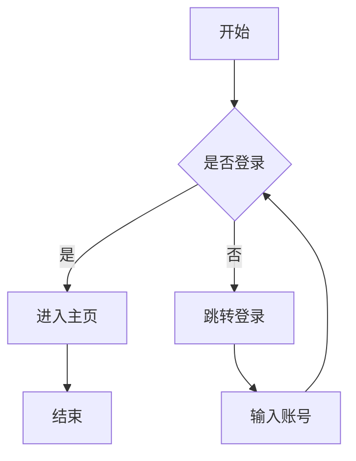
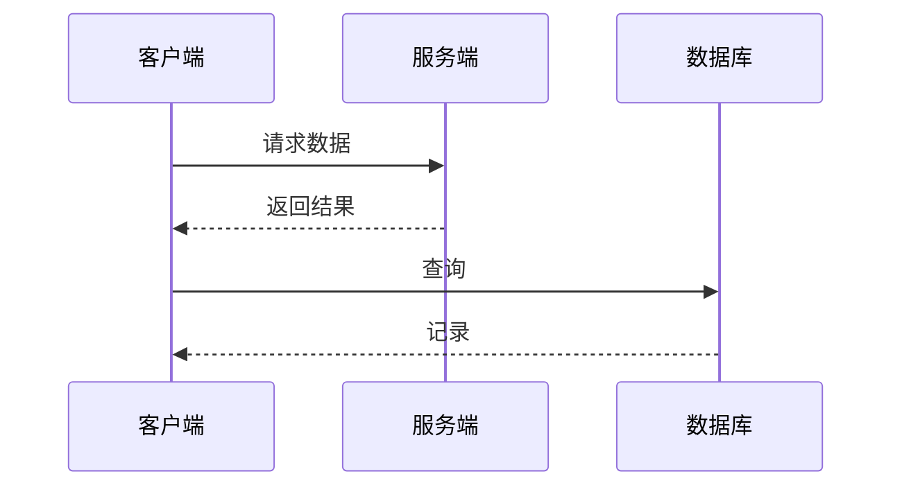
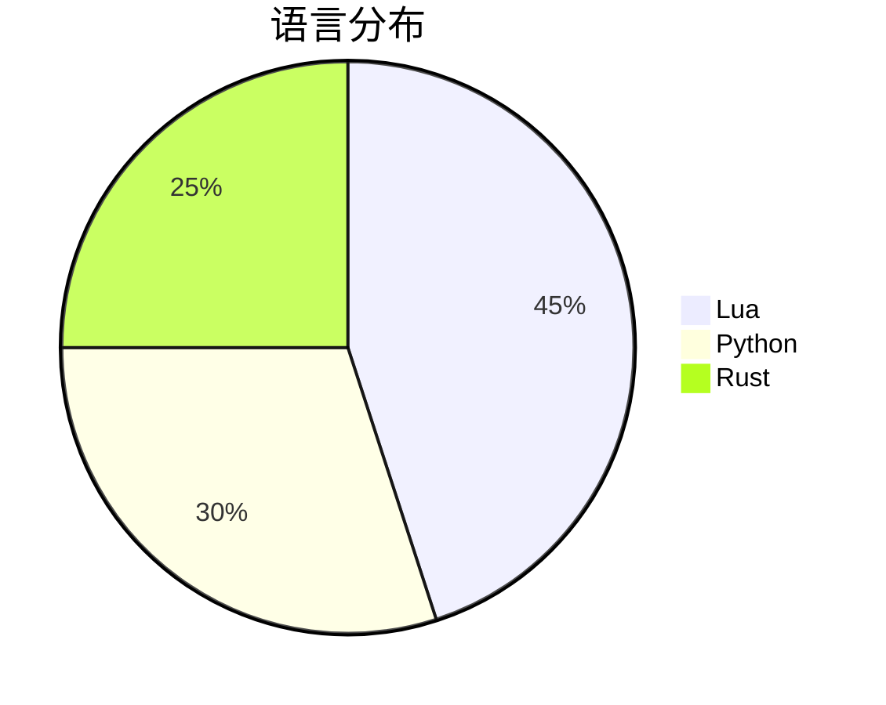

# 一级标题

这是**粗体**、*斜体*、***粗斜体***、~~删除线~~、==高亮==、`行内代码`与[链接](https://neovim.io)。

行内公式 $E = mc^2$ 可以直接转换。

## 二级标题

### 三级标题

#### 四级标题

##### 五级标题

###### 六级标题

## 列表

- 项目一
- 项目二
  - 嵌套项 A
  - 嵌套项 B
    - 三级嵌套
- [x] 已完成任务
- [ ] 未完成任务

1. 有序一
2. 有序二
3. 有序三

## 引用

> 引用块第一行
> 引用块第二行
>
> 引用内也可以有 **强调** 和 `代码`。

## 表格

| 名称 | 数量 | 单价 | 说明 |
|:-----|:----:|-----:|:-----|
| 苹果 | 3 | 5.00 | 水果 |
| 中文列名 | 12 | 1.50 | 测试中文对齐 |
| mixed 混合 | 8 | 2.25 | 中英混排 |

## 代码块

```lua
local function greet(name)
  -- 问候某人
  local msg = "你好, " .. name
  return msg
end
```

```python
def fib(n: int) -> int:
    """斐波那契"""
    if n < 2:
        return n
    return fib(n - 1) + fib(n - 2)
```

```bash
# 安装依赖
npm install -g neovim
```

## 数学公式

行内：$a^2 + b^2 = c^2$，$\sum_{i=1}^{n} x_i$

块级：

$$
\int_{0}^{\infty} e^{-x^2} dx = \frac{\sqrt{\pi}}{2}
$$

$$
\begin{bmatrix}
1 & 2 \\
3 & 4
\end{bmatrix}
\begin{pmatrix}
a \\
b
\end{pmatrix}
=
\begin{pmatrix}
a + 2b \\
3a + 4b
\end{pmatrix}
$$

## 流程图



横向布局：


## 时序图



## 不支持的图类型（降级为源码）



## 脚注

这里有一个脚注引用[^note]。

[^note]: 脚注内容会显示在文档底部。

---

## 链接引用写法

参考 [Neovim 官网][nvim] 与 [Lua 手册][lua]。

[nvim]: https://neovim.io
[lua]: https://www.lua.org/manual/5.1/
